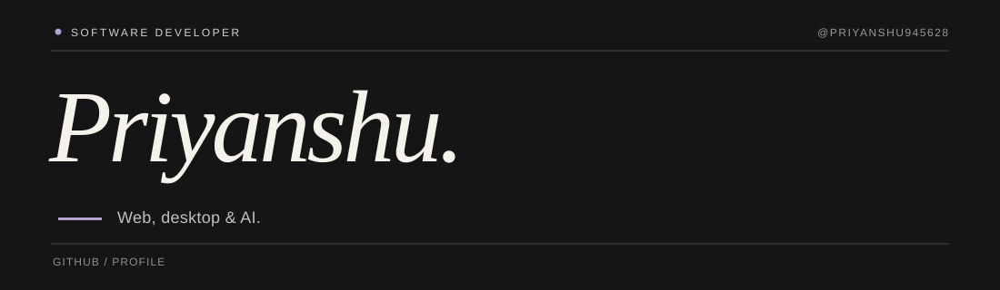

<picture>
  <source media="(max-width: 600px)" srcset="./assests/hero-mobile.svg">
  
</picture>

  <a href="https://editor-portfolio.up.railway.app/">Portfolio</a>
  &nbsp; · &nbsp;
  <a href="https://github.com/Priyanshu945628?tab=repositories">Repositories</a>

---

### About

I'm **Priyanshu**. I work on Windows software, web apps and AI-assisted workflows.

I enjoy making tools that are useful, fast, and straightforward to use. I care just as much about the interface as the code behind it.

### What I use

**Languages:** TypeScript, JavaScript, Python, C++, Rust

**Web:** React, Next.js, Node.js

**Desktop & tools:** Tauri, SQLite, GitHub Actions

### Interests

Product engineering · Interface design · Automation · Software security
